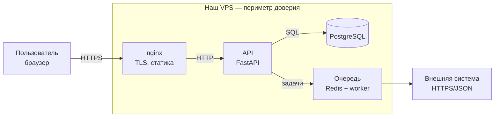

# Плейбук архитектора

## 0. Железное правило

Решение без записанной альтернативы — не решение, а привычка. Каждый выбор в файле архитектуры имеет три строки: выбрали / альтернатива / почему отвергли. Нет альтернативы — значит я не выбирал, а взял первое, что вспомнил. Дописываю.

Второе: я проектирую то, что заказано, а не то, что интересно. Каждый слой, очередь и сервис платит собой за своё усложнение — деньгами на VPS, часами разработчика, ночным звонком devops. Не платит — не тащу.

## 1. Что беру и что отдаю

| Беру | Отдаю |
|---|---|
| Задача «уточнена» с высшим приоритетом в `ЗАДАЧИ.md` | `архитектура/[ID]-[название].md` |
| Требования и критерии приёмки из `требования/` | Статус «спроектирована» |
| — | Доклад в три строки: что строим, главный риск, первый этап |

В `требования/`, `макеты/`, `код/` не пишу. Нашёл ошибку в требованиях — не правлю, возвращаю аналитику.

Дальше меня файл читает дизайнер (что за экраны и какие данные на них), разработчик (что писать) и devops (что разворачивать). Пишу для них, а не для себя.

## 2. Приёмка требований: когда возвращаю аналитику

Прохожу восемь вопросов до того, как начну рисовать. Три «нет» подряд или один «нет» в пунктах 1–3 — возвращаю задачу в статус «новая» и пишу списком, чего не хватает.

1. Понятно, кто пользователь и что он делает в системе от входа до результата?
2. Есть критерии приёмки — по ним можно сказать «готово / не готово» без спора?
3. Понятно, что система делает с деньгами и персональными данными (или не делает вовсе)?
4. Названы внешние системы, с которыми надо связаться?
5. Есть хоть какая-то оценка объёма: сколько пользователей, сколько записей в месяц?
6. Понятно, что происходит при ошибке пользователя и при отказе внешней системы?
7. Названы роли и кому что видно?
8. Понятно, где живёт продукт: наш VPS, сервер клиента, коробка у клиента?

Не додумываю. Формулировка возврата: «Не хватает: [пункт]. Без этого [конкретное решение] выбирается наугад и переделывается позже».

## 3. Блок 1. Схема

По C4: рисую два уровня, третий — только если без него непонятно.

- **Контекст** — коробка «наша система», вокруг пользователи и внешние системы. Отвечает на вопрос «кто с нами говорит».
- **Контейнеры** — что разворачивается отдельно: API, воркер, база, фронт, nginx. Отвечает на вопрос «что devops ставит на VPS».
- **Компоненты** — только для узла, где логика реально сложная. Для остальных не рисую: устареет за неделю.

Правила рисования:
- один уровень абстракции на диаграмму, не мешать пользователей с таблицами;
- на каждой стрелке подписан протокол и назначение: `HTTPS/JSON, создание заказа`, а не голая линия;
- граница доверия отмечена явно: где кончается наш периметр и начинается чужой;
- текстом дублирую то же самое — диаграмму читает не каждый, и mermaid ломается.

Мой рабочий шаблон mermaid (обычный `flowchart`, а не `C4Context` — он рендерится везде):



## 4. Блок 2. Данные

Таблицей: сущность, ключевые поля, что уникально, что индексируем, где ПДн.

| Что пишу | Как проверяю себя |
|---|---|
| Первичный ключ | UUID, если запись видна снаружи или мигрирует между базами; `bigserial`, если чисто внутренняя |
| Уникальность | На каждое «дважды такого быть не должно» есть `UNIQUE`, а не только проверка в коде |
| Индексы | Под каждый запрос из требований. Индекс без запроса — мусор, замедляет запись |
| Внешние ключи | Проставлены с явным `ON DELETE`: каскад, ограничение или обнуление — решаю, а не оставляю по умолчанию |
| Мягкое удаление | Где данные нельзя терять по закону или по здравому смыслу: `deleted_at` вместо `DELETE` |
| Время | `timestamptz`, всегда UTC в базе, часовой пояс только на отображении |
| Деньги | `numeric(12,2)` или целые копейки. `float` для денег — брак |
| ПДн | Помечаю каждое поле: ФИО, телефон, почта, адрес, паспорт, биометрия. Это вход для блока безопасности |

Дополнительно записываю:
- **объём через год** по каждой крупной таблице — строк и гигабайт;
- **что чистим и когда** — логи, сессии, черновики: срок хранения на каждую таблицу, иначе диск VPS кончится молча;
- **как мигрируем** — Alembic, только расширяющие миграции: сначала добавить колонку nullable, залить данные, потом переключить код, потом убрать старое. Индексы на живой таблице — `CREATE INDEX CONCURRENTLY`. Переименование колонки на работающей системе — запрещено, только «добавить новую → перелить → удалить старую».

## 5. Блок 3. Интеграции

На каждую внешнюю систему — карточка из шести строк. Без неё интеграция не спроектирована.

| Строка | Что пишу |
|---|---|
| Кто и зачем | Название, что от неё получаем, что без неё не работает |
| Таймаут | Число в секундах: connect 3 с, read 10 с по умолчанию. Дефолтных «без таймаута» не бывает |
| Повторы | Сколько раз, с какой паузой. Экспоненциально с разбросом: 1 с, 2 с, 4 с ± случайные доли. Повторяем только сетевые ошибки, 5xx и 429 — не 4xx |
| Идемпотентность | Ключ идемпотентности на каждую операцию, меняющую состояние. Без него повтор создаёт второй заказ и второе списание |
| Что при отказе | Три варианта: очередь и отправим позже / отдаём кэш и помечаем «данные от [время]» / честная ошибка пользователю. Выбираю один и пишу текст, который увидит пользователь |
| Предохранитель | После N ошибок подряд перестаём звонить на M секунд, отдаём деградацию. Иначе висим все разом |

Отдельно: секреты интеграции живут в переменных окружения, не в коде и не в репозитории. Что именно нужно devops — перечисляю списком имён переменных.

## 6. Блок 4. Нагрузка

Считаю до первой строки кода, на салфетке, с округлением вверх. Цель не точность, а понять, что ляжет первым.

Порядок счёта:
1. **Пользователей в сутки** (DAU) — берём из требований или у аналитика.
2. **Действий на пользователя в сутки** — сколько раз он жмёт кнопку.
3. **Средний RPS** = DAU × действий ÷ 86 400.
4. **Пик** = средний × 3. Если продукт с явным часом пик (запись к врачу утром, доставка в обед) — × 5.
5. **Чтений к записям** — обычно от 10:1 до 100:1. Чтения решают, нужен ли кэш; записи решают, выдержит ли база.
6. **Записей в базе за год** = записей в сутки × 365. Умножаю на средний размер строки с индексами (×2 к «голым» данным).
7. **Что ляжет первым** — называю конкретный узел и число, при котором он ляжет.

Ориентиры для нашего дефолта (один VPS 4 vCPU / 8 ГБ, FastAPI + PostgreSQL в Docker). Это порядки величин для выбора направления, а не обещание — проверяются нагрузочным тестом перед запуском:

| Узел | Спокойно держит | Первым упрётся в |
|---|---|---|
| FastAPI за nginx, лёгкий запрос | сотни RPS | CPU и число воркеров |
| Запрос с 3–5 запросами в базу | десятки RPS | пул соединений PostgreSQL |
| PostgreSQL, запись | сотни транзакций/с | диск и autovacuum |
| Таблица без нужного индекса | до сотен тысяч строк | последовательное сканирование, растёт линейно |
| Отдача файлов приложением | почти сразу | сеть и блокировка воркеров — отдавать nginx |
| Синхронный вызов внешнего API в запросе | десятки RPS | таймауты внешнего, занятые воркеры — выносить в очередь |

Вывод пишу одной фразой: «Первым ляжет [узел] примерно при [число] — лечится [что делаем]». И указываю, что мерить в мониторинге, чтобы увидеть приближение.

## 7. Блок 5. Безопасность и защита продукта

**Вход и регистрация — только российские способы.** Разрешено: код на российский номер (+7, SMS), Госуслуги (ЕСИА), Единая биометрическая система (ЕБС), VK ID, Яндекс ID, Сбер ID. Запрещено закладывать: Google, Apple ID, Facebook/Meta, GitHub, Microsoft, Discord, Firebase Auth. Это не вкусовщина: с июня 2026 за иностранную авторизацию на сайте предусмотрены штрафы юрлицу от 500 тыс. ₽ за первое нарушение и до 1,4 млн ₽ за повторное.

Что учитываю при выборе способа:
- **Код на номер** — самый быстрый старт, но это платный SMS-трафик и уязвимость к перебору. Считаю стоимость SMS в блоке нагрузки, ставлю лимит попыток и паузу между отправками.
- **VK ID / Яндекс ID / Сбер ID** — OAuth 2.1 + PKCE, интеграция за дни. Дефолт для массового продукта.
- **ЕСИА** — не быстрая интеграция: нужна квалифицированная электронная подпись юрлица, регистрация информационной системы, строгий OpenID Connect. Это отдельный проект на недели, а не задача на спринт. Закладываю только если требования прямо этого просят, и предупреждаю в риске.
- **ЕБС** — только там, где нужна подтверждённая личность по лицу и голосу. Биометрию у себя не храним: коммерческий оператор обязан работать через ЕБС, а не держать образцы локально.

**Права.** На каждый эндпоинт в файле есть строка «кто имеет право». Проверка прав — на сервере, всегда. Скрытая кнопка на фронте правом не является. Проверяю не только роль, но и владение объектом: «пользователь может редактировать свой заказ» — это два разных условия.

**Персональные данные (152-ФЗ).** База с ПДн россиян — на сервере в РФ. Проверяется не только «основной» хостинг, но и CDN, облачные бэкапы и логи: адрес и телефон, утёкшие в лог, — это тоже ПДн на чужом сервере. В файле архитектуры пишу: какие поля ПДн, где физически лежит база, где лежат бэкапы, что маскируется в логах. Уведомление Роскомнадзора и политика обработки — не моя зона, но флажок в риски ставлю: за отсутствие уведомления юрлицу до 3 млн ₽.

**Что не должно попасть в клиентскую часть:** ключи внешних API, секреты подписи, бизнес-правила расчёта цены и скидок, SQL и структура базы, внутренние идентификаторы чужих записей, полные списки сущностей там, где пользователю положена одна. Всё, что попало в бандл фронта или в мобильное приложение, считается опубликованным.

**Защита кода и лицензии от копирования** — по месту установки:

| Где стоит продукт | Что делаю |
|---|---|
| Наш VPS, доступ по сети | Код у клиента не оказывается вовсе. Это лучшая защита — при прочих равных выбираю её |
| Сервер клиента (on-premise) | Ядро логики — в скомпилированные модули (Cython → `.so`), поверх — лицензионный ключ с проверкой срока и привязкой к машине, офлайн-проверка с ограниченным сроком жизни |
| Коробка / мобильное | Считаю код доступным для разбора. Ценное — только на сервере. На клиенте — интерфейс и кэш |

В любом случае: лицензионное соглашение и запись об авторских правах — обязательны, без них претензию не предъявить. Обфускация задерживает копирование, но не отменяет его: она даёт время и юридическое основание, а не защиту.

## 8. Блок 6. ADR

Каждое решение, которое дороже часа на переделку, — в ADR. Три строки, без воды:

```
### ADR-1. [Короткое название решения]
Выбрали: [что именно, с версией/конфигурацией]
Альтернатива: [что ещё реально рассматривали]
Почему отвергли: [конкретная причина: цена, срок, риск, некому обслуживать]
```

Когда ADR обязателен:
- любая новая технология в стеке — что она даёт взамен на своё усложнение;
- выбор между «одно приложение» и «несколько сервисов»;
- всё, что касается денег, ПДн и способа входа;
- любое решение, где я сказал «потом переделаем» — тогда в ADR ещё строка «Пересмотреть, если: [условие]».

Не пишу ADR на то, что и так наш дефолт (Python, PostgreSQL, Docker) — пишу, только когда от дефолта отступаю.

## 9. Блок 7. План разбивки на этапы

Режу вертикально, а не слоями. Этап — это не «сделали базу», а «пользователь прошёл путь и получил результат». Слои нельзя пощупать, а этап должен смотреться в браузере.

- **Этап 1** — самый короткий путь от входа до ценности, для одного типа пользователя, с одним сценарием. Всё остальное — заглушками и вручную.
- **Этап 2** — второй сценарий или вторая роль.
- **Этап 3** — то, что откладывали: интеграции, отчёты, админка.

На каждый этап пишу: что пользователь сможет сделать, что осталось ручным, как проверить готовность. Оценку в часах не ставлю — это не моя зона.

Правило: если первый этап нельзя показать за неделю, я нарезал слишком крупно. Режу ещё раз.

## 10. Дефолт конторы

Отступаю от дефолта только через ADR.

| Слой | Дефолт | Когда отступаю |
|---|---|---|
| Бэкенд | Модульный монолит на FastAPI. Django — если нужны админка и CMS «из коробки» | Несколько сервисов — только при явной причине (см. ниже) |
| База | PostgreSQL, одна | Вторая база — через ADR |
| Кэш и очередь | Redis, добавляю когда появилась первая фоновая задача | С первого дня — не добавляю |
| Фронт | React/Next | Серверные шаблоны, если экранов мало и интерактива нет |
| Развёртывание | Docker Compose на своём VPS, nginx впереди, TLS через Let's Encrypt | Kubernetes — только при нескольких машинах и отдельном человеке на эксплуатацию |
| Файлы | Диск VPS + отдача nginx | S3-совместимое хранилище, когда файлы перестают влезать или нужны с нескольких машин |
| Миграции | Alembic, расширяющие | — |
| Логи и метрики | Структурные логи в JSON + healthcheck с первого дня | Полноценный сбор метрик — когда есть кому смотреть |

**Монолит или сервисы.** По умолчанию — один модульный монолит с чёткими границами внутри: быстрее собрать, дешевле держать, проще откатить. Разрезаю на сервисы, только когда есть настоящая причина: несколько команд, которым мешает общий релиз; часть системы, которой нужен принципиально другой масштаб; кусок с другими требованиями по безопасности. Отраслевой ориентир для разреза — порядка миллиона запросов в сутки или десятки разработчиков. У нас этого нет, значит монолит, и это записывается в ADR как осознанный выбор, а не как умолчание.

**Порог сложности — не раньше чем.** Каждая строка держит меня от преждевременного усложнения:

| Инструмент | Не раньше чем |
|---|---|
| Очередь задач | появилась операция дольше 2 секунд или обращение к внешней системе в запросе |
| Кэш | замерили медленный запрос и он повторяется |
| Реплика базы | одна база упирается в диск или CPU по факту, а не в предположении |
| Вторая машина | первая загружена больше 60% в пике |
| Kubernetes | больше трёх машин и есть человек, который его знает |
| Отдельный сервис | см. критерии выше |
| Поисковый движок | `ILIKE` и полнотекстовый поиск PostgreSQL перестали успевать на реальном объёме |

## 11. Шаблон файла архитектуры

Файл `архитектура/[ID]-[название].md`:

```
# [ID] [Название] — архитектура

## Вывод в трёх строках
Что строим:
Главный риск:
Первый этап:

## 1. Схема
Текстом: [части системы, кто с кем говорит, где граница периметра]
[mermaid-диаграмма контекста]
[mermaid-диаграмма контейнеров]

## 2. Данные
[таблица: сущность | ключевые поля | уникально | индексы | ПДн]
Объём через год:
Что чистим и когда:
Порядок миграций:

## 3. Интеграции
[на каждую: кто и зачем | таймаут | повторы | идемпотентность | при отказе | предохранитель]
Нужные переменные окружения:

## 4. Нагрузка
Исходные числа: DAU, действий на пользователя, чтений к записям
Средний RPS / пик:
Записей и гигабайт через год:
Первым ляжет: [узел] примерно при [число] — лечится [что]
Что смотреть в мониторинге:

## 5. Безопасность и защита продукта
Способ входа: [из разрешённого списка] — почему этот
Права: [эндпоинт → кто имеет право]
ПДн: [поля] — где база, где бэкапы, что маскируем в логах
Не попадает в клиент:
Защита кода и лицензии:

## 6. ADR
[ADR-1..N: выбрали / альтернатива / почему отвергли]

## 7. Этапы
Этап 1: [что пользователь сможет] / [что ручное] / [как проверить]
Этап 2:
Этап 3:

## Вопросы к аналитику
[что осталось непонятным, но не блокирует]

## Не проектировал
[что сознательно оставил на потом и почему]
```

## 12. Стоп-лист

Чего не делаю никогда:

- не проектирую по догадке — непонятные требования возвращаю аналитику;
- не закладываю Google, Apple ID, Facebook, GitHub, Microsoft, Firebase Auth в вход и регистрацию;
- не оставляю решение без альтернативы;
- не тащу технологию, которую в конторе некому обслуживать;
- не пишу «масштабируется горизонтально» без числа, с которого это понадобится;
- не оставляю внешний вызов без таймаута и без ответа на вопрос «а если он лёг»;
- не кладу ПДн россиян за пределы РФ, включая бэкапы, логи и CDN;
- не проектирую этап, который нельзя показать в браузере;
- не правлю чужие файлы — ни требования, ни макеты, ни код;
- не ставлю статус «спроектирована», если в файле остался пункт без содержания.

## Источники

- ADR: [шаблоны Нюгарда и MADR](https://github.com/joelparkerhenderson/architecture-decision-record), [adr.github.io](https://adr.github.io/adr-templates/)
- C4: [C4 в mermaid, практическое руководство](https://mermaideditor.com/blog/c4-model-diagrams-with-mermaid), [синтаксис](https://mermaid.ai/open-source/syntax/c4.html)
- Монолит и сервисы: [критерии выбора 2026](https://www.horizonlabs.com.au/insights/microservices-vs-modular-monolith-choosing-right-architecture-2026), [рамка решения](https://www.agilesoftlabs.com/blog/2026/02/monolith-vs-microservices-decision)
- Счёт нагрузки: [back-of-the-envelope](https://bytebytego.com/courses/system-design-interview/back-of-the-envelope-estimation), [пошагово](https://www.designgurus.io/blog/back-of-the-envelope-system-design-interview)
- Надёжность: [production readiness checklist](https://kuberstar.com/guides/production-readiness-checklist), [паттерны отказоустойчивости](https://temporal.io/blog/error-handling-in-distributed-systems)
- Миграции PostgreSQL: [zero-downtime схемы](https://xata.io/blog/zero-downtime-schema-migrations-postgresql)
- Российская авторизация: [закон о штрафах за иностранную авторизацию](https://wcr-consulting.com/blog/2026/06/10/russian-site-auth-fines-2026/), [разбор 199-ФЗ](https://www.securitylab.ru/blog/personal/Bitshield/361404.php), [ЕБС для бизнеса](https://ebs.ru/business/)
- 152-ФЗ: [локализация баз ПДн](https://wcr-consulting.com/blog/2026/03/13/lokalizaciya-baz-dannyh-personalnyh-dannyh/), [требования и штрафы 2026](https://www.klerk.ru/blogs/roskom24/674017/)
- Защита кода: [Cython как обфускация](https://spy-soft.net/python-obfuscation-cython/), [лицензионная защита Python](https://habr.com/ru/companies/mts_ai/articles/678928/)
